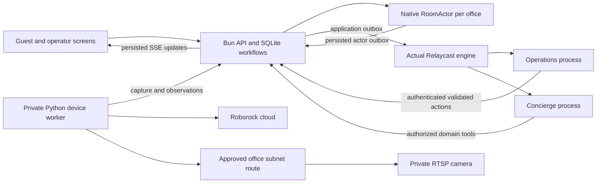

# ODAS baseline handoff

## Architecture and contracts

This is a new self-contained TypeScript monorepo. The React 19/Vite 8/Tailwind 4 frontend calls a Bun/Hono API. The account/catalog/commerce/conversation database is SQLite in WAL mode, with uniqueness and revision/CAS constraints. The release uses one API replica. Terse's actual Durable Actors SDK 0.14.9 owns serialized room inventory and operational decisions. The generated server-only client calls a separate native actor runtime locally and the official managed Terse endpoint in production.

Actual `@agent-relay/sdk` 15.0.1 participants run as two separate application processes against the actual self-hosted Relaycast engine 12.3.0. Their identities and workspace credentials persist privately with the Relay database. Node 22.23.4 is pinned for Relaycast's better-sqlite3 dependency; an observed Node 24 native crash was resolved by using Node 22. Bun 1.4.4 runs the API and workers. Python 3.13.7 uses locked python-roborock 7.13.0 and aiohttp 3.14.5 for the authenticated backend device worker; FFmpeg runs one long-lived capture process per configured RTSP camera.

[Contract v1](contracts.md) and `packages/contracts/src/index.ts` define stable IDs, timestamps, money, actor commands, event envelopes, and HTTP route ownership. Timestamps are UTC epoch milliseconds. User time input uses the selected date in America/Los_Angeles with ambiguous/nonexistent DST times rejected. Domain events include version, eventID, room/booking IDs, correlationID, revision, idempotency key, and occurredAt. Capture and inference times remain distinct.

Native actor commands persist state and intent transactionally. Native alarms expire holds and evidence, with isolated controlled-clock ticks used only in tests. Actor pending events survive restart. Operations inserts both consumer targets into the application outbox before acknowledging actor events. Separate Relay messages carry domain events and business results. A transport receipt is not business completion. Processed-message records deduplicate domain actions; retrying a delivery produces a fresh result acknowledgment, with bounded SHA256 transport idempotency keys.

## Actual file ownership

| Initial owner | Files |
| --- | --- |
| Integration lead | Root manifests/lockfile, tsconfig, contracts, db/config/core/API composition, generated client, React entry/App/api/styles, seed/start/deploy files, GitHub checks, docs/review |
| Marketplace owner | apps/api/src/catalog/*; apps/web/src/marketplace/* |
| Commerce owner | apps/api/src/commerce/*; apps/web/src/commerce/*; delegated scripts/scenario.ts |
| Room operations owner | packages/actors/*; apps/api/src/operations/*; apps/web/src/operations/*; workers/device/*; delegated scripts/integration.ts |
| Concierge owner | packages/concierge/*; apps/api/src/concierge/*; apps/web/src/concierge/* |

The flat team started with five total agents. Planning estimates were 4 agents at 230 minutes, 5 agents at 200 minutes, and 6 agents at 195 minutes including coordination; five was the smallest within 10% of the fastest estimate. These were estimates, not measured speedups. The integration lead published shared types and file boundaries before parallel feature implementation.

## Commands and seeds

`bun install --frozen-lockfile` installs exact releases from `bun.lock`. `bun run dev` launches the frontend, API, native local actors, actual Relaycast engine, Python worker, and both runtime agents. uv initializes the locked Python environment. `bun run build` builds the frontend; `bun run typecheck` checks the shared stack. `bun run seed --dev-accounts` explicitly seeds ordinary dev accounts; generated passwords are only in the ignored private credential file. Production starts with `bun run start` in the container and requires the managed Terse URL/key and explicit internal secrets.

`scripts/seed.ts` seeds these explicit modeled groups, without inferring group membership from location:

| Stable group ID | Group | Offices | Base USD/hour |
| --- | --- | ---: | ---: |
| polk-310 | 507 Polk St, Suite 310 |9|3.57|
| mission-400 | 1360 Mission St, Floor 4 / Suite 400 |8|5.23|
| market-1540-f3 | 1540 Market St, Floor 3 |7|6.09|
| gough-207 | 44 Gough St, Suite 207 |1|6.33|
| post-204 | 2211 Post St, Suite 204 |3|6.50|
| market-870-1242 | 870 Market St, Suite 1242 |3|7.30|

Office IDs append `-office-01` and subsequent two-digit numbers to the group ID. Rates default to the group and support per-office overrides. Seed coordinates match the supplied positions. Every group is modeled. Hours 08:00 to 20:00 daily are configurable test hours; real access is unverified. Photos, dimensions, capacities, amenities, and access stay unknown. The only initial device binding is the explicitly labeled simulator for `polk-310-office-01`.

## Financial and recovery behavior

Quotes bind user, room, interval, rate, subtotal, 10% fee, total, currency, policy, and expiry. A 45-minute hold accommodates Stripe's minimum 30-minute Checkout expiry, with Checkout expiring before the native hold. Quotes expire after 10 minutes. No client price overrides are accepted. Checkout uses the pinned official Stripe SDK 23.1.0 and its bundled 2026-10-28.endive API, dynamic payment methods, and a stable integration identifier. Automatic tax is not enabled. Seller payouts and host onboarding are outside this MVP.

Signed raw-body webhooks and authenticated reconciliation call the same persisted fulfillment operation. Stripe payment state, currency, amount, metadata, ownership, and booking identity are validated. Duplicates are idempotent. Unfulfillable paid inventory is refunded; refund request/pending/succeeded/failed states remain separate. SQLite workflow leases and CAS guard concurrent processes, with retries using provider idempotency keys.

The default cancellation policy gives a full refund before start and for an ODAS service disruption; ordinary cancellation after check-in creates operator review. Replacements search actual compatible available inventory, preferring the same workspace and preserving interval and amount paid. Unknown requirements are disclosed. The resumable swap records planned/acquired/replacement_confirmed/assigned/complete stages. It confirms replacement inventory before releasing the original and preserves the public reservation ID. Stale/expired offers leave the original recoverable.

## Verification evidence

- TypeScript checks and a production frontend build passed. No new unit-test framework or creation-only tests were added.
- Native Terse actor checks used a real separate runtime and an actual process restart. Competing holds, expiry, durable confirmed inventory, pending job/outbox recovery, vacancy freshness, out-of-order frames, observed motion/completion, people interruption, and post-clean inspection passed. The repeatable runner is `bun run test:integration`; latest lead-reviewed evidence is `docs/verification/integration.json` before final CI.
- Commerce integration passed ordinary Argon2id signup/HttpOnly durable sessions, guest ownership, public operator escalation denial, integer fees, competing holds, real Stripe sandbox Checkout creation/idempotency/expiration, signed webhook replay/tamper rejection, and actual inventory swaps. The interrupted swap test recreated the service after replacement confirmation and recovered the original reservation without a second payment.
- Marketplace checks passed 6 groups / 31 offices, minimum matching rates357/523/609/633/650/730 cents, unknown-capacity exclusion, modeled hours, date-specific PDT/PST conversion, ambiguous-time rejection, and private access-detail exclusion.
- Actual cross-process Relay proof passed saved chat -> real catalog tool -> saved reply -> business-result DM -> completed outbox. Verified real message IDs include 242357550964809728 and 242357652714430464. Duplicate reply suppression, cross-user 404, and SSE Last-Event-ID replay passed. Model reasoning was not invoked; development rules mode is explicit.
- The browser created an ordinary guest, navigated workspace/office pages with the dated interval preserved, reviewed the exact 785-cent total, acquired native inventory, and completed Stripe sandbox Checkout using Stripe's test card. Reservation `odas_50d7f717-1ce3-4325-961d-f6ab3f4198f7` became confirmed/paid from authoritative provider state. Its subsequent cancellation refunded 785 cents; Stripe refund `re_3UWhGuIuSYU4gqXk42O8uVqZ` returned succeeded. Signed `refund.updated` event `evt_3UWhGuIuSYU4gqXk4SfP17X1` reached the API withHTTP 200 via StripeCLI forwarding. No live charge was made.
- The Docker image built with frozen Bun/Python dependencies. A separate container review stack was healthy at 127.0.0.1:5174, with its own native actors, Relay, workers, and simulator. Payments were explicitly unconfigured in that independent package review.
- `bun run test:scenario` passed all seven grouped checks on the November 1, 2026 Pacific test date. [Scenario evidence](verification/scenario.json) records the 9:45 scheduled end,9:55 departure,10:05 expected readiness, real Relay delivery, persisted SSE/chat offer, decline/expiry/acceptance behavior, stable real inventory/booking/amount, duplicate delivery handling, and a full stack restart. New workers reconnected with fresh heartbeats. Native actor ownership recovered after 26.5 seconds; lease fencing was preserved. The initial funding is explicitly synthetic; successful Stripe payment/refund were verified separately above.
- Root HTTP checks passed missing-CSRF and wrong-Origin 403 responses, guest/operator separation, private camera authorization, cross-guest reservation 404, and operator workspace scope 403.
- Browser operator checks passed normal login, 31 scoped offices, inspection, requested/observed simulated cleaning, docking, honest camera fallback, and a rate override followed by restoration to the group rate. Mobile 390px layout had no horizontal overflow. Keyboard navigation reached the dated time control, the native concierge dialog focused its heading, and Escape restored focus to its launcher. [Screenshots](review/marketplace.jpg) capture the desktop marketplace, with separate mobile, operator, and sandbox refund images in `docs/review`.
- The native integration rerun after the interruption fix also passed. Interruption and subsequent observed docking invalidate earlier frames; only fresh post-dock inspection can establish readiness. [Integration evidence](verification/integration.json) records the actual native restart and commerce phases.

## External configuration and physical tests

No cloud staging target, managed Terse project credentials, DNS, or hosting deployment secrets existed in the new repository. [Deployment inputs](../deploy/README.md) describe those requirements. A container build or local native actor server is not evidence of a hosted Terse deployment. No production promotion is authorized in this task.

The real Q10/B01 adapter, persistent account connection, telemetry, vacuum-only start, and dock methods are implemented against the installed python-roborock API. The camera adapter uses a long-lived FFmpeg pipeline, and the configured TypeSafe image provider returns typed occupancy/floor/surface inspection. Physical Roborock authentication/telemetry/motion/docking, camera/VPN reachability, image-provider inference, and real cleaning effectiveness remain unverified while equipment and credentials are unavailable. Provider image integration is documented as experimental; do not treat people detection as certified.

The office gateway advertises the private camera subnet; the backend must accept the approved route and be able to reach it from inside the container. No public RTSP exposure is configured. A Q10 cloud/internet outage can prevent stop/dock delivery. Unknown or stale observations block new dispatch, and uncertain physical commands require telemetry reconciliation rather than blind replay. Manual attention-task closure records evidence but does not establish readiness.

The concierge model adapter requires real credentials and an explicitly configured model ID for model mode. Its Responses/tool path is implemented and input-validated, but a real model call was not made in this verification. This release used the identified rules mode through actual services and Relay.

The integration lead owns the shared type declarations in `packages/actors/src/contracts.ts`, re-exported by `packages/contracts/src/index.ts`. This keeps the official managed Terse source archive self-contained; app runtime schemas and constants remain in `packages/contracts`. The actor contract is unchanged. The standalone actor package also installed from its own lockfile and passed TypeScript checking outside the monorepo; managed upload/deployment still requires Terse credentials.
